# RBM OpenArm

## Demo

<p align="center">
  <video src="demo.mp4" width="420" controls playsinline></video>
</p>

<p align="center"><a href="demo.mp4">demo.mp4</a>（仓库根目录）</p>

基于 Ubuntu 22.04 / ROS 2 Humble 的移动双臂机器人工程，集成：

- OpenArm V10 双臂、夹爪、ros2_control、MoveIt 2
- AgileX Ranger Mini 3.0 底盘
- 胸前 RealSense D435I + 双腕 RealSense D405
- PICO + XRoboToolkit VR 遥操作（臂 + 底盘）
- 根目录 `data_collection/`：HDF5 示教采集与回放

> **安全**：首次启动真机前请释放急停、架空底盘、清空机械臂工作空间，并准备随时断电。在 CAN 接口、机械零位和电机 ID 未确认前，不要启动真实硬件。

日常推荐入口：先 [§1](#1-仿真--真机运行前联机-pc-service-与-pico) 联机 PC Service / PICO，再 [§2 快捷启动](#2-快捷启动控制菜单) — [`control_menu.sh`](openarm_ws/scripts/control_menu.sh)（11–14）。环境搭建见 [§3](#3-系统要求) 起。

---

## 从零复现清单（clone 后必读）

**本仓库只含源码**：不含 `openarm_ws/{build,install,log}` 的编译产物，也不含数据集（`datasets*/`，已在 `.gitignore` 中排除）。clone 后**必须自行编译**，不能直接运行。

1. 安装 Ubuntu 22.04 + ROS 2 Humble，装齐 apt 依赖 → [§3](#3-系统要求)
2. clone（**带子模块**，本仓库有 5 个 submodule）：

   ```bash
   git clone --recurse-submodules <本仓库地址> ~/Medibot_openarm
   cd ~/Medibot_openarm
   ```

   若已 clone 但漏了子模块：`git submodule update --init --recursive`
3. 安装 XRoboToolkit PC Service（`.deb`，VR 遥操作必需）→ [§5.1](#51-安装-xrobotoolkit-pc-service-deb)
4. 创建 conda 环境 `openarm` 并安装 VR / 采集 Python 依赖 → [§5.2](#52-创建-openarm)–[§5.3](#53-vr-与采集-python-依赖)

   > 子模块里的 `third_party/XRoboToolkit-PC-Service-Pybind/setup_ubuntu.sh` 默认执行 `conda install -c conda-forge ...`；若 conda-forge 慢或被墙，可临时去掉 `-c conda-forge` 改用默认 channel。
5. 安装 PICO 头显端 APK（仅 VR）→ [§5.4](#54-安装-pico-头显-apk)
6. **编译工作空间**：`./openarm_ws/scripts/build.sh` → [§6](#6-构建与加载环境)
7. 每次使用前加载环境：`source source_all.sh`
8. 首次配置 CAN（udev 持久绑定 + 免密 sudo，只需一次）→ [§7](#7-can-接口)
9. 启动：`./openarm_ws/scripts/control_menu.sh`；首次用 `11`，日常数据采集用 `13` → [§2](#2-快捷启动控制菜单)

**两个已知坑**（详见 [§14 常见问题](#14-常见问题)）：

- **代理变量**：XRoboToolkit PC Service 必须在**没有 `http_proxy` / `ALL_PROXY` 等代理变量**的终端里启动，否则它不会监听头显用的 63901 端口，头显会一直"无法连接"（`control_menu.sh` 已自动清理，若手动启动需自行 `unset`）。
- **CAN 接口名**：需与 udev 绑定一致 —— `can0`/`can1` 为双臂的 `peak_usb`（CAN-FD 1M/5M），`can2` 为底盘的 `gs_usb`（500k）。名字错位时菜单会明确报错并拒绝启动机械臂，而不是让驱动"假激活"（表现为程序正常但机械臂不动）。

---

## 目录

1. [仿真 / 真机运行前：联机 PC Service 与 PICO](#1-仿真--真机运行前联机-pc-service-与-pico)
2. [快捷启动（控制菜单）](#2-快捷启动控制菜单)
3. [系统要求](#3-系统要求)
4. [获取代码](#4-获取代码)
5. [Conda 与 VR 运行时](#5-conda-与-vr-运行时)
6. [构建与加载环境](#6-构建与加载环境)
7. [CAN 接口](#7-can-接口)
8. [OpenArm 双机械臂](#8-openarm-双机械臂)
9. [Ranger Mini 3.0 底盘](#9-ranger-mini-30-底盘)
10. [RealSense 三相机](#10-realsense-三相机)
11. [VR 遥操作](#11-vr-遥操作)
12. [HDF5 数据采集与回放](#12-hdf5-数据采集与回放)
13. [命令行全栈启动](#13-命令行全栈启动)
14. [常见问题](#14-常见问题)
15. [参考资料](#15-参考资料)

---

## 1. 仿真 / 真机运行前：联机 PC Service 与 PICO

做 VR 相关快捷启动（菜单 **5 / 8 / 12 / 13**）前，先完成本节。仅机械臂假硬件、底盘键盘、相机可视化时可跳过。

1. **同网**：机器人 PC 与 PICO 4 Ultra 连同一局域网（Wi‑Fi / 有线均可）。
2. **PC 端启动 XRoboToolkit PC Service**（需已按 [§5.1](#51-安装-xrobotoolkit-pc-service-deb) 安装 deb）：
   - 双击桌面 / 应用菜单中的 `XRoboToolkit-PC-Service`，或执行：

```bash
bash /opt/apps/roboticsservice/runService.sh
```

成功后会弹出服务窗口，例如：

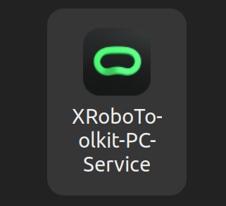

3. **头显端**：在 PICO 上打开 App `XRoboToolkit`（APK 安装见 [§5.4](#54-安装-pico-头显-apk)）。PC Service 与头显联机成功后，服务窗口侧通常会显示已连接设备，例如：

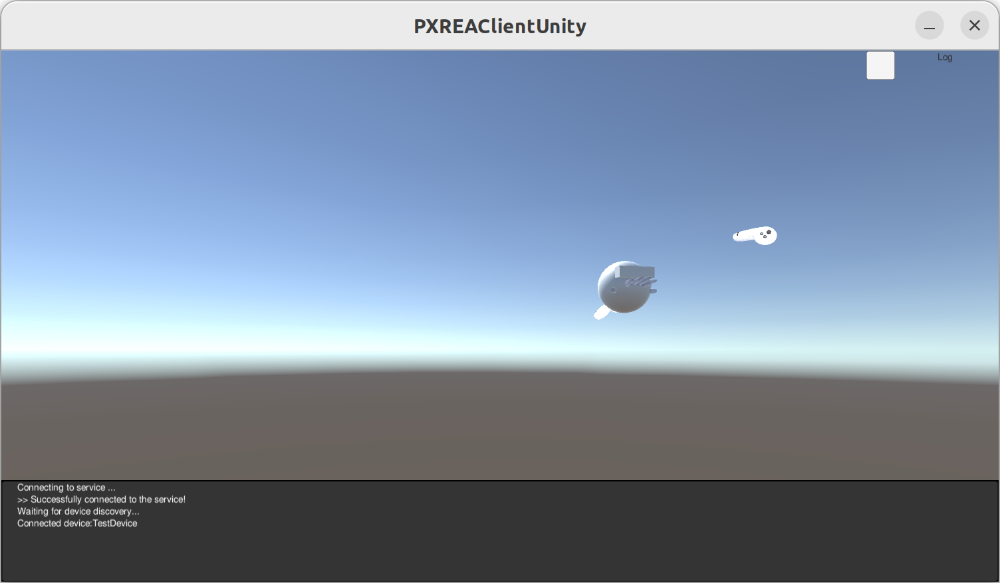

Unity 客户端说明见 [XRoboToolkit-Unity-Client](https://github.com/XR-Robotics/XRoboToolkit-Unity-Client)。

4. **再启本仓库遥操作**：联机正常后，用 [§2 快捷启动](#2-快捷启动控制菜单)（如菜单 **12** 全身 VR，或 **5 + 8**）。本工程请走 `control_menu.sh` / `launch_vr_teleop.sh`，不必再跟上游 [XRoboToolkit-Teleop-Sample-Python](https://github.com/XR-Robotics/XRoboToolkit-Teleop-Sample-Python) 的示例脚本。

---

## 2. 快捷启动（控制菜单）

环境已按后文搭好后，日常直接用控制菜单启动（需图形桌面终端）。未构建时请先完成 [§3](#3-系统要求)–[§6](#6-构建与加载环境)。VR 相关请先完成 [§1](#1-仿真--真机运行前联机-pc-service-与-pico)。

```bash
cd ~/Medibot_openarm
./openarm_ws/scripts/control_menu.sh
```

菜单示例：

```text
==========================================
          RBM OpenArm 控制菜单
==========================================
【快速启动】
 11. 首次启动
 12. 全身 VR 遥操作
 13. 数据采集
 14. 数据回放

【分布步骤】
  1. 安装 CAN 绑定（仅首次）
  2. 启动全部 CAN（can0/can1/can2）
  3. 启动 OpenArm 驱动
  4. 启动 OpenArm MoveIt 控制（需先启动 3）
  5. 启动 OpenArm VR 遥操作（与 4 冲突）
  6. 启动底盘控制
  7. 启动底盘键盘控制（需先启动 6）
  8. 启动底盘 VR 遥操作
  9. 启动 camera+rviz 可视化
  0. 关闭本菜单启动的全部终端并退出
------------------------------------------
推荐：日常用 11（仅首次）/12/13/14；需拆分时再用 1–9。
提示：CAN 建议先配免密 sudo（见 §7）；菜单 1/2/11–14 会在主窗口安装一次，之后不再要密码。
提示：VR 臂启动到 hands_up，握把跟随；X/A=复位；结束或按 0 时回 home。
提示：回放(14)勿与 VR/MoveIt 同时开；采集数据在 datasets/。
提示：启动真机前请确认急停、CAN 接口及工作空间安全。
请输入序号 [0-9,11-14]：
```

| 序号 | 作用 |
|------|------|
| **11** | 首次：安装 CAN 绑定 + 启动全部 CAN |
| **12** | 全身 VR（CAN + 臂 VR + 底盘 VR） |
| **13** | 数据采集（VR + 相机 + 采集脚本） |
| **14** | 数据回放（底盘 + FP 驱动 + 相机 + RViz + replay） |
| **1–9** | 分布步骤拆分调试 |
| **0** | 关闭本菜单启动的全部终端 |

说明：

- CAN 免密见 §7 `install_passwordless_sudo.sh`。
- 采集/回放请用 **13 / 14**；数据写入 `datasets/`。
- 回放勿与 VR（5/12/13）或 MoveIt（4）同时开。
- VR 臂：启动后到 `hands_up`，握把跟随（缓入）；**X**=左臂、**A**=右臂复位；结束或按 **0** 时回 `home`。

---

## 3. 系统要求

| 项 | 说明 |
|----|------|
| OS | Ubuntu 22.04 |
| ROS | ROS 2 Humble（须先按 [官方文档](https://docs.ros.org/en/humble/Installation.html) 装好 `/opt/ros/humble`） |
| Python | 系统 Python 3.10 用于 colcon；Conda `openarm` 也用 3.10 |
| Conda | Miniconda / Anaconda（VR、采集/回放） |
| 硬件相关 | `can-utils`、SocketCAN 适配器；VR 另需 XRoboToolkit PC Service |

### 3.1 首次安装顺序（推荐）

1. 安装 ROS 2 Humble  
2. [§3.2](#32-apt-依赖) 安装 apt 依赖  
3. [§4](#4-获取代码) 克隆仓库并初始化子模块  
4. [§5.1](#51-安装-xrobotoolkit-pc-service-deb) 安装 XRoboToolkit PC Service（`.deb`）  
5. [§5.2](#52-创建-openarm)–[§5.3](#53-vr-与采集-python-依赖) 创建 `openarm` 并安装 VR/采集 Python 依赖  
6. [§5.4](#54-安装-pico-头显-apk)（仅 VR）安装 PICO 端 APK  
7. [§6](#6-构建与加载环境) `build.sh` 编译并 `source_all.sh`  
8. VR 前按 [§1](#1-仿真--真机运行前联机-pc-service-与-pico) 联机，再 [§2](#2-快捷启动控制菜单) 快捷启动

### 3.2 apt 依赖

一次性安装编译与运行所需包（缺任一常见依赖会导致对应包编译失败，见 [§14](#14-常见问题)）：

```bash
sudo apt update
sudo apt install -y \
  can-utils git libasio-dev libboost-all-dev \
  python3-colcon-common-extensions python3-h5py python3-numpy python3-pil \
  ros-humble-compressed-image-transport \
  ros-humble-controller-manager ros-humble-diagnostic-updater \
  ros-humble-hardware-interface ros-humble-librealsense2 \
  ros-humble-moveit ros-humble-moveit-ros-perception \
  ros-humble-ros2-controllers ros-humble-teleop-twist-keyboard \
  ros-humble-xacro
```

| 包 | 用途 |
|----|------|
| `libasio-dev` | 底盘 `ugv_sdk` 编译（缺则报 `asio.hpp: No such file`） |
| `ros-humble-hardware-interface` 等 | OpenArm `ros2_control` / MoveIt |
| `ros-humble-librealsense2` | RealSense SDK（供工作空间内 `realsense2_camera` 链接） |
| `ros-humble-diagnostic-updater` | RealSense 相机节点依赖 |
| `ros-humble-compressed-image-transport` | 发布 `/.../compressed`；RViz 与 `data_collection` 默认用压缩图 |

---

## 4. 获取代码

```bash
git clone --recurse-submodules https://github.com/LuckyPBJY/Medibot_openarm.git ~/Medibot_openarm
cd ~/Medibot_openarm
git submodule update --init --recursive
```

若仓库已存在但子模块目录为空（例如未加 `--recurse-submodules`），在仓库根目录再执行一次：

```bash
cd ~/Medibot_openarm
git submodule update --init --recursive
```

主要目录：

```text
Medibot_openarm/
├── openarm_ws/
│   ├── src/
│   │   ├── arm/       # OpenArm、MoveIt、CAN、机械臂遥操作
│   │   ├── chassis/   # Ranger 驱动、VR 底盘控制
│   │   ├── sensors/   # RealSense
│   │   └── teleop/    # XR Bridge、VR IK
│   └── scripts/       # build / control_menu / CAN / 相机 / VR
├── data_collection/   # HDF5 采集与回放（非 ROS 包）
├── third_party/       # XRoboToolkit 等子模块
├── docs/              # 文档与附件
├── source_all.sh      # 统一加载 ROS 环境
└── datasets/          # 运行时数据（默认不提交）
```

---

## 5. Conda 与 VR 运行时

仅做机械臂/底盘/相机、不做 VR 时，可跳过 [§5.1](#51-安装-xrobotoolkit-pc-service-deb)、[§5.4](#54-安装-pico-头显-apk)，但仍建议创建 [§5.2](#52-创建-openarm) 以便后续采集。

### 5.1 安装 XRoboToolkit PC Service（deb）

PC 端 VR 数据服务，提供 `libPXREARobotSDK.so`（XR Bridge / `xrobotoolkit_sdk` 运行时依赖）。请先下载 Ubuntu 22.04 的 deb（勿用源码替代本步骤，除非你明确要自行编译 PC Service）：

- 发布页下载：[XRoboToolkit_PC_Service_1.0.0_ubuntu_22.04_amd64.deb](https://github.com/XR-Robotics/XRoboToolkit-PC-Service/releases/download/v1.0.0/XRoboToolkit_PC_Service_1.0.0_ubuntu_22.04_amd64.deb)
- 源码仓库（可选）：[XRoboToolkit-PC-Service](https://github.com/XR-Robotics/XRoboToolkit-PC-Service)

安装：

```bash
# 进入 deb 所在目录后执行（文件名以实际下载为准）
sudo dpkg -i XRoboToolkit_PC_Service_1.0.0_ubuntu_22.04_amd64.deb
```

若提示依赖缺失：

```bash
sudo apt -f install -y
sudo dpkg -i XRoboToolkit_PC_Service_1.0.0_ubuntu_22.04_amd64.deb
```

安装后目录为 `/opt/apps/roboticsservice/`。启动 PC Service（图形界面或脚本均可）：

```bash
bash /opt/apps/roboticsservice/runService.sh
```

也可在应用菜单打开 `XRoboToolkit-PC-Service`。启动成功后会弹出服务窗口；再打开 PICO 头显端的 `XRoboToolkit` App，并保证头显与 PC 同一局域网。

验证：

```bash
ls /opt/apps/roboticsservice/SDK/x64/libPXREARobotSDK.so
ls /opt/apps/roboticsservice/runService.sh
```

更完整的迁移说明见 [`docs/openarm/vr_deployment_guide.md`](docs/openarm/vr_deployment_guide.md)。

### 5.2 创建 `openarm`

ROS 工作空间用**系统 Python** 构建；`openarm` 仅用于 VR、采集/回放与相关 Python 工具。

若 `conda create` 提示需接受 Anaconda Terms of Service：

```bash
conda tos accept --override-channels --channel https://repo.anaconda.com/pkgs/main
conda tos accept --override-channels --channel https://repo.anaconda.com/pkgs/r
```

然后创建环境：

```bash
conda create -n openarm python=3.10 -y
conda activate openarm
python -m pip install "empy==3.3.4" catkin_pkg
```

验证：

```bash
conda activate openarm
python --version          # 应为 3.10.x
python -c "import em, catkin_pkg; print('ok')"
```

不要在已激活 Conda 时直接跑普通 `colcon build`。请使用仓库的 `build.sh`：它会隔离 Conda，避免与 ROS Humble 的 `empy` / `catkin_pkg` 冲突。

### 5.3 VR 与采集 Python 依赖

本仓库 VR 运行时检查的是 `xrobotoolkit_sdk` + `placo`（见 `launch_vr_teleop.sh`），**不需要** torch / CUDA。请先完成 [§5.1](#51-安装-xrobotoolkit-pc-service-deb)，再编译 Python 绑定（`setup_ubuntu.sh` 会链接 PC Service 的 SDK）。

不要执行：

- `third_party/XRoboToolkit-Teleop-Sample-Python/setup_conda.sh --install`（会装完整 `xrobotoolkit_teleop` 并拉取 torch/CUDA）
- `setup_conda.sh --conda openarm`（会先删除现有 `openarm` 环境）

推荐安装：

```bash
conda activate openarm

# VR：Python SDK 绑定 + IK（子模块须已 init）
cd ~/Medibot_openarm/third_party/XRoboToolkit-PC-Service-Pybind
bash setup_ubuntu.sh
pip install placo

# 采集 / 回放
pip install h5py opencv-python pyyaml
```

验证：

```bash
conda activate openarm
python -c "import xrobotoolkit_sdk, placo, h5py, cv2, yaml; print('VR/采集依赖 ok')"
```

若使用预打包环境：

```bash
source ~/Medibot_openarm/openarm_env/bin/activate
```

### 5.4 安装 PICO 头显 APK

仅 VR 需要。先在 PICO（如 PICO 4 Ultra）开启开发者模式，并在 PC 上装好 [`adb`](https://developer.android.com/tools/adb)；头显用数据线连接 PC 并允许调试。

下载 APK：

- [XRoboToolkit-PICO-1.1.1.apk](https://github.com/XR-Robotics/XRoboToolkit-Unity-Client/releases/download/v1.1.1/XRoboToolkit-PICO-1.1.1.apk)
- Unity 客户端说明：[XRoboToolkit-Unity-Client](https://github.com/XR-Robotics/XRoboToolkit-Unity-Client)

安装到头显：

```bash
adb install -g XRoboToolkit-PICO-1.1.1.apk
```

成功时类似：

```text
Performing Streamed Install
Success
```

头显上打开 App `XRoboToolkit`，与已启动的 PC Service 联机后即可做遥操作。

---

## 6. 构建与加载环境

```bash
cd ~/Medibot_openarm
./openarm_ws/scripts/build.sh
source ~/Medibot_openarm/source_all.sh
```

说明：

- `build.sh` 固定使用系统 `/usr/bin/python3`，即使当前 shell 已 `conda activate openarm` 也可安全执行  
- 工作空间约 **17** 个 ROS 2 包；`data_collection/` 在仓库根目录，不参与 colcon  
- 编译前请确认 [§3.2](#32-apt-依赖) 已装全，否则常见失败见下表

| 报错关键词 | 缺少的包 |
|------------|----------|
| `asio.hpp` | `libasio-dev` |
| `hardware_interface` | `ros-humble-hardware-interface`（及 controller / MoveIt 相关） |
| `diagnostic_updater` / `realsense2` | `ros-humble-diagnostic-updater`、`ros-humble-librealsense2` |

成功构建类似：

```text
Starting >>> openarm_can
Starting >>> openarm_description
Starting >>> openarm_bringup
Starting >>> openarm_xr_bridge
Starting >>> ranger_msgs
Starting >>> ugv_sdk
Starting >>> rbm_base_control
Starting >>> realsense2_camera_msgs
Starting >>> realsense2_description
...
Finished <<< openarm
Finished <<< openarm_bimanual_moveit_config
Finished <<< openarm_vr_ik_teleop
Finished <<< ranger_base
Finished <<< realsense2_camera

Summary: 17 packages finished
```

每个新终端：

```bash
source ~/Medibot_openarm/source_all.sh
```

可选写入 `~/.bashrc`：

```bash
echo 'source ~/Medibot_openarm/source_all.sh' >> ~/.bashrc
```

快速自检：

```bash
source ~/Medibot_openarm/source_all.sh
ros2 pkg list | grep -E 'openarm|ranger|realsense|rbm'
```

---

## 7. CAN 接口

约定：

| 接口 | 用途 | 驱动 / 速率 |
|------|------|-------------|
| `can0` | OpenArm 右臂 | PEAK `peak_usb` 通道 0，CAN-FD 1M/5M |
| `can1` | OpenArm 左臂 | PEAK `peak_usb` 通道 1，CAN-FD 1M/5M |
| `can2` | Ranger 底盘 | `gs_usb`，500 kbps |

OpenArm 双通道 USB-CANFD 通讯卡接线示意（面板丝印：`CAN0` / `CAN1`；DB9 常用 **2=CAN-L、3=CAN-GND、7=CAN-H**；按设备说明设置 120Ω 终端电阻）：

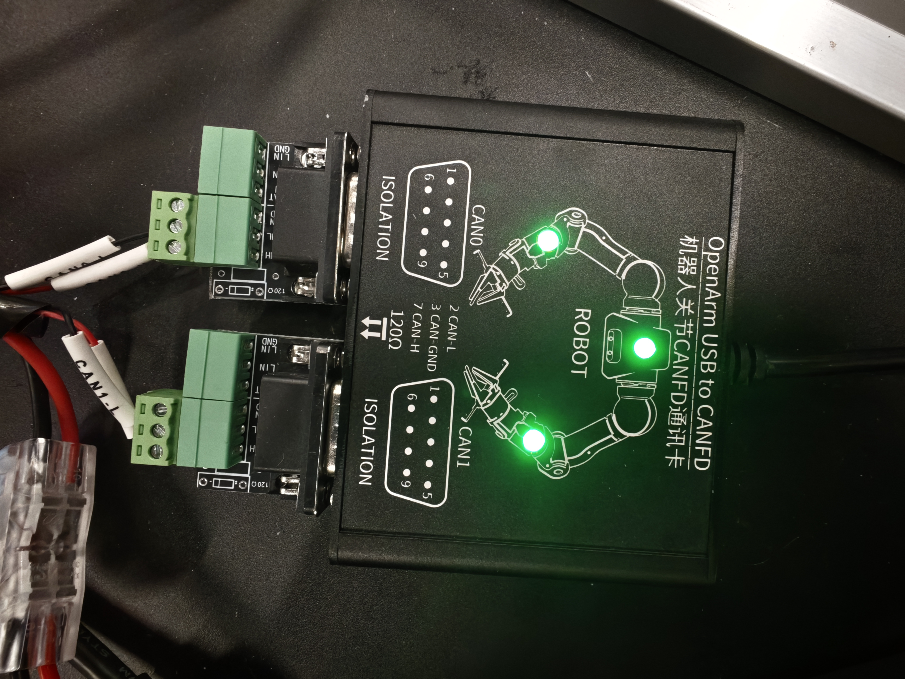

USB 同时插入时，内核可能按枚举顺序分配接口名。请先安装持久绑定（菜单 **11** 或 **1**）：

```bash
cd ~/Medibot_openarm
sudo ./openarm_ws/scripts/can/install_can_bindings.sh
```

可选（推荐）：为本机用户配置 CAN 脚本 **sudo 免密**（只需一次，之后菜单 1/2/11–14 不再询问密码；**不会**把登录密码写入仓库）：

```bash
bash ./openarm_ws/scripts/can/install_passwordless_sudo.sh
```

规则：

- `peak_usb` + `dev_id=0x0` → `can0`
- `peak_usb` + `dev_id=0x1` → `can1`
- `gs_usb` → `can2`

每次重新插拔或重启后（菜单 **2** / **11–14** 也会做）：

```bash
sudo ./openarm_ws/scripts/can/bringup_can.sh --all
# 或仅机械臂 / 仅底盘：
# sudo ./openarm_ws/scripts/can/bringup_can.sh --arm
# sudo ./openarm_ws/scripts/can/bringup_can.sh --chassis
```

成功时类似：

```text
Configuring can0...
can0 is now set to CAN FD mode (1000000 bps / 5000000 bps)
✓ can0 is active
Configuring can1...
can1 is now set to CAN FD mode (1000000 bps / 5000000 bps)
✓ can1 is active
✓ can2 is up (bitrate 500000, gs_usb)
```

也可单独配置机械臂：

```bash
sudo ./openarm_ws/src/arm/openarm_can/setup/configure_socketcan.sh can0 -fd
sudo ./openarm_ws/src/arm/openarm_can/setup/configure_socketcan.sh can1 -fd
ip -details link show can0
ip -details link show can1
```

配置成功时：

```text
Configuring can0...
can0 is now set to CAN FD mode (1000000 bps / 5000000 bps)
✓ can0 is active
Configuring can1...
can1 is now set to CAN FD mode (1000000 bps / 5000000 bps)
✓ can1 is active
```

监听总线：

```bash
candump can0   # 右臂
candump can1   # 左臂
```

电机已供电并正常通信时，类似：

```text
can0  011  [08]  11 81 03 7F F7 FF 1B 18
can0  001   [8]  FF FF FF FF FF FF FF FC
```

CAN ID 与数据随电机状态变化。若完全无输出，仅“接口 UP”不够，还需检查供电、急停、CAN_H/CAN_L、终端电阻和 USB-CAN。

---

## 8. OpenArm 双机械臂

### 8.1 仿真 / 假硬件

未接真机时必须 `use_fake_hardware:=true`：

```bash
source ~/Medibot_openarm/source_all.sh
ros2 launch openarm_bringup openarm.bimanual.launch.py \
  arm_type:=v10 \
  use_fake_hardware:=true \
  launch_rviz:=true
```

正常启动关键输出：

```text
[INFO] [robot_state_publisher-1]: process started
[INFO] [ros2_control_node-2]: process started
[INFO] [rviz2-3]: process started
[ros2_control_node-2] [INFO] [resource_manager]: Successful initialization of hardware 'openarm_left_hardware_interface'
[ros2_control_node-2] [INFO] [resource_manager]: Successful initialization of hardware 'openarm_right_hardware_interface'
[spawner] [INFO]: Configured and activated left_joint_trajectory_controller
[spawner] [INFO]: Configured and activated right_joint_trajectory_controller
[spawner] [INFO]: Configured and activated joint_state_broadcaster
[rviz2-3] [INFO]: OpenGl version: 4.3 (GLSL 4.3)
```

RViz 双臂模型：

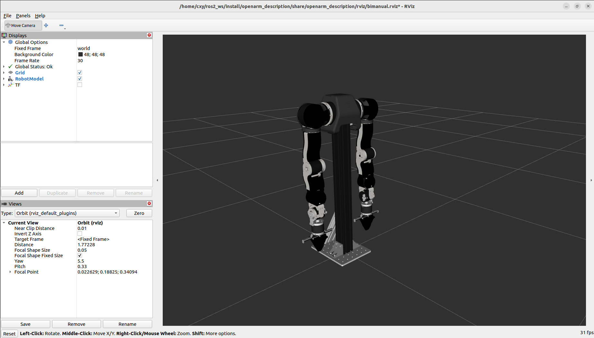

### 8.2 真实双臂

确认 `can0`/`can1` 正常且周围安全后（菜单 **3** 为轨迹控制器）：

```bash
source ~/Medibot_openarm/source_all.sh
ros2 launch openarm_bringup openarm.bimanual.launch.py \
  arm_type:=v10 \
  use_fake_hardware:=false \
  right_can_interface:=can0 \
  left_can_interface:=can1 \
  launch_rviz:=true
```

VR / 回放使用 `forward_position_controller`（菜单 **5/12/13** 自带；**14** 也会启动）：

```bash
ros2 launch openarm_bringup openarm.bimanual.launch.py \
  arm_type:=v10 \
  use_fake_hardware:=false \
  robot_controller:=forward_position_controller \
  launch_rviz:=false
```

### 8.3 MoveIt 2

假硬件：

```bash
source ~/Medibot_openarm/source_all.sh
ros2 launch openarm_bimanual_moveit_config demo.launch.py \
  arm_type:=v10 use_fake_hardware:=true
```

真实机械臂（也可菜单 **3 → 4**）：

```bash
ros2 launch openarm_bimanual_moveit_config demo.launch.py \
  arm_type:=v10 use_fake_hardware:=false \
  right_can_interface:=can0 left_can_interface:=can1
```

MoveIt 规划界面：

左臂：

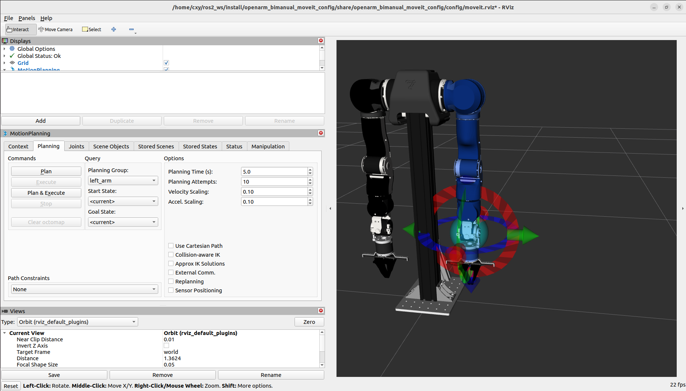

右臂：

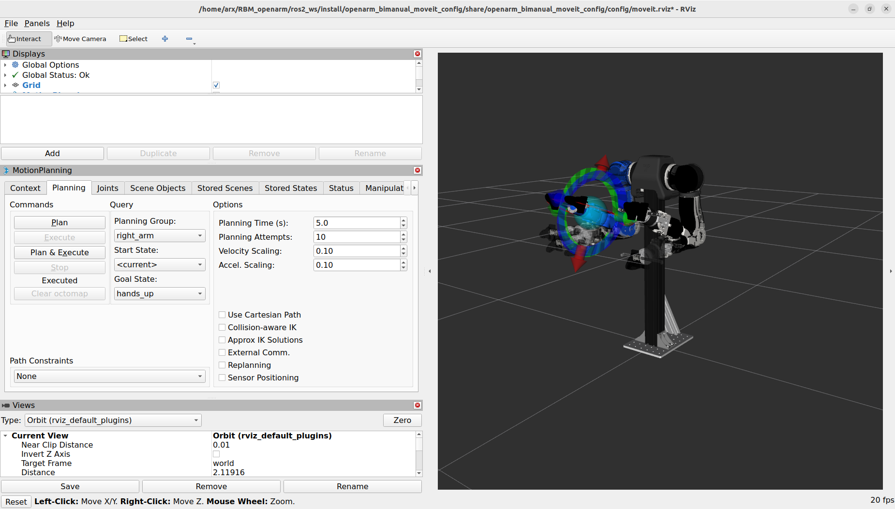

夹爪：

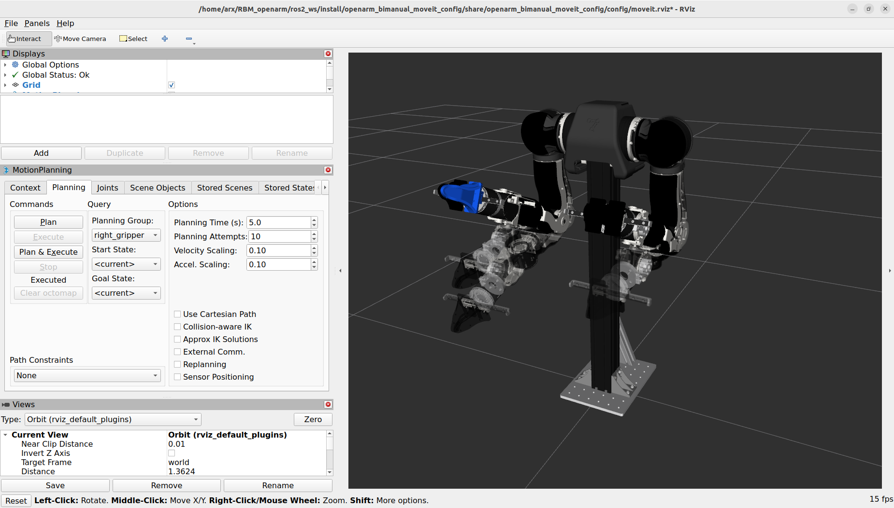

### 8.4 首次零位标定

仅在机械安装、换电机或零位丢失后执行；标定过程中手臂会运动：

```bash
sudo apt install -y software-properties-common
sudo add-apt-repository -y ppa:openarm/main
sudo apt update
sudo apt install -y libopenarm-can-dev openarm-can-utils

# 左臂
openarm-can-zero-position-calibration --canport can1 --arm-side left_arm

# 右臂
openarm-can-zero-position-calibration --canport can0 --arm-side right_arm
```

标定输出示例（角度以现场为准）：

```text
# 左臂
parser arg : Namespace(canport='can1', arm_side='left_arm')
Enabling...
Enabled...
[INFO] mechanical stop (Joint J1): 0.0011 rad / 0.07°
[INFO] mechanical stop (Joint J4): -0.0908 rad / -5.20°
[INFO] mechanical stop (Joint J3): 1.5549 rad / 89.09°
[INFO] mechanical stop (Joint J5): 1.6491 rad / 94.49°
[INFO] mechanical stop (Joint J6): 0.7542 rad / 43.21°
[INFO] mechanical stop (Joint J7): 1.5435 rad / 88.43°
[INFO] mechanical stop (Joint J2): 0.0206 rad / 1.18°
wrote zero positon to arm
[INFO] Motors disabled, exiting safely.

# 右臂
parser arg : Namespace(canport='can0', arm_side='right_arm')
Enabling...
Enabled...
[INFO] mechanical stop (Joint J1): 0.0023 rad / 0.13°
[INFO] mechanical stop (Joint J4): -0.0008 rad / -0.04°
[INFO] mechanical stop (Joint J3): 1.7388 rad / 99.62°
[INFO] mechanical stop (Joint J5): 1.6018 rad / 91.78°
[INFO] mechanical stop (Joint J6): 0.7713 rad / 44.19°
[INFO] mechanical stop (Joint J7): 1.5377 rad / 88.11°
[INFO] mechanical stop (Joint J2): -0.2121 rad / -12.15°
wrote zero positon to arm
[INFO] Motors disabled, exiting safely.
```

---

## 9. Ranger Mini 3.0 底盘

### 9.1 硬件准备

1. 连接底盘 CAN_H / CAN_L 与 USB-CAN
2. 打开底盘电源并释放两侧急停
3. 接口 `can2`，波特率 500 kbps

遥控器按键：

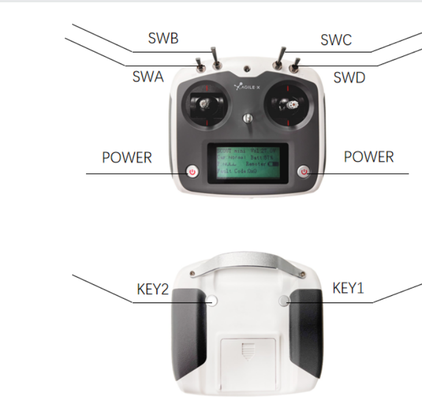

开机：`SWA`/`SWB`/`SWC`/`SWD` 全部向上，再同时按住两个 `POWER`。自检时向下拨 `SWA` 与左侧滚轮，同时长按背面 `KEY1`/`KEY2`，底盘应转动两次。

USB-CAN 线序：

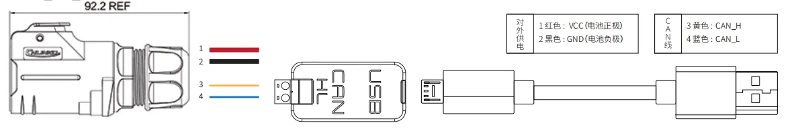

实际连接示例：

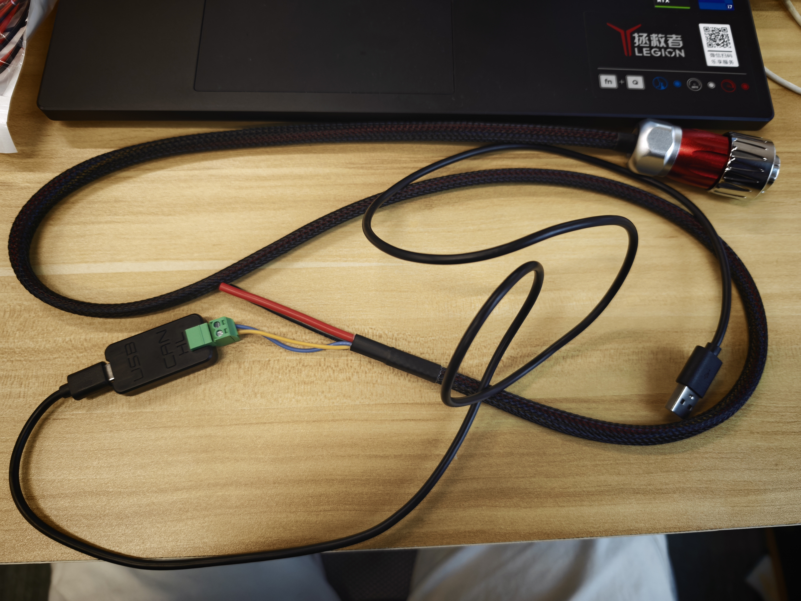

首次还可执行上游脚本（建议仍先装本仓库持久绑定）：

```bash
cd ~/Medibot_openarm
sudo ./openarm_ws/scripts/can/install_can_bindings.sh
sudo bash openarm_ws/src/chassis/ranger_ros2/ranger_bringup/scripts/setup_can2usb.bash
```

之后每次重启或插拔：

```bash
sudo ./openarm_ws/scripts/can/bringup_can.sh --chassis
# 或：
sudo bash openarm_ws/src/chassis/ranger_ros2/ranger_bringup/scripts/bringup_can2usb.bash
candump can2
```

底盘正常供电并释放急停后，`candump can2` 类似：

```text
can2  221   [8]  00 00 00 00 00 00 00 11
can2  281   [8]  00 00 00 00 00 00 00 00
can2  271   [8]  00 12 FF EE FF EE 00 12
can2  241   [8]  AA FE 00 00 00 00 02 7D
can2  251   [8]  00 00 00 0D FF FF FE 66
can2  252   [8]  00 00 00 0C 00 00 00 44
can2  211   [8]  00 00 01 EF 00 00 00 00
can2  291   [2]  00 00
```

底盘脚本只操作 `gs_usb` → `can2`，不会误改 OpenArm 的 `peak_usb` `can0/can1`。

### 9.2 启动底盘驱动

菜单 **6**，或：

```bash
source ~/Medibot_openarm/source_all.sh
ros2 launch ranger_bringup ranger_mini_v3.launch.py port_name:=can2
```

正常启动：

```text
[INFO] [ranger_base_node-1]: process started
[ranger_base_node-1] [INFO] [ranger_base_node]: Successfully loaded the following parameters:
[ranger_base_node-1]  port_name: can2
[ranger_base_node-1]  robot_model: ranger_mini_v3
[ranger_base_node-1]  odom_frame: odom
[ranger_base_node-1]  base_frame: base_link
[ranger_base_node-1]  update_rate: 50
[ranger_base_node-1]  odom_topic_name: odom
[ranger_base_node-1]  publish_odom_tf: 0
[ranger_base_node-1] Start listening to port: can2
```

检查话题：

```bash
ros2 topic echo /odom
ros2 topic echo /cmd_vel
```

### 9.3 键盘控制

推荐：先菜单 **6** 启动底盘驱动，再菜单 **7**。或手动：

```bash
source ~/Medibot_openarm/source_all.sh
ros2 run teleop_twist_keyboard teleop_twist_keyboard
```

启动后按键说明：

```text
This node takes keypresses from the keyboard and publishes them
as Twist/TwistStamped messages. It works best with a US keyboard layout.
---------------------------
Moving around:
   u    i    o
   j    k    l
   m    ,    .

For Holonomic mode (strafing), hold down the shift key:
---------------------------
   U    I    O
   J    K    L
   M    <    >

anything else : stop
q/z : increase/decrease max speeds by 10%
w/x : increase/decrease only linear speed by 10%
e/c : increase/decrease only angular speed by 10%
CTRL-C to quit

currently:        speed 0.50        turn 1.00
```

`i/k/,` 前进/停/退，`j/l` 转向，`Ctrl+C` 退出。

### 9.4 VR 摇杆控底盘

推荐菜单 **8** 或快速启动 **12**。手动时：

```bash
bash /opt/apps/roboticsservice/runService.sh
```

新终端：

```bash
conda activate openarm
source ~/Medibot_openarm/source_all.sh
~/Medibot_openarm/openarm_ws/install/openarm_xr_bridge/share/openarm_xr_bridge/scripts/run_xr_bridge.sh
```

再启摇杆映射：

```bash
source ~/Medibot_openarm/source_all.sh
ros2 launch rbm_base_control base_controller.launch.py
```

连接成功并操作摇杆时类似：

```text
XRoboToolkit SDK initialized.
[INFO] [base_controller]: XR controller ready: left Y controls forward/backward, right X controls rotation.
[INFO] [base_controller]: cmd_vel linear.x=0.000, angular.z=-0.000
initialize sdk,connect127.0.0.1:60061client start
server connect
device found
TestDevice
[INFO] [base_controller]: cmd_vel linear.x=0.080, angular.z=-0.000
[INFO] [base_controller]: cmd_vel linear.x=0.100, angular.z=-0.120
```

左摇杆 Y = 前后，右摇杆 X = 旋转。当前限速（采集/回放发布 `/cmd_vel` 时同步限幅）：

```text
openarm_ws/src/chassis/rbm_base_control/config/base_controller.yaml
  linear_speed: 0.1    # m/s
  angular_speed: 0.2   # rad/s
  deadzone: 0.1
```

---

## 10. RealSense 三相机

| 名称 | 位置 | 序列号 | 分辨率 |
|------|------|--------|--------|
| `camera_l` | 左腕 D405 | `260322278361` | 640×480@30 |
| `camera_h` | 胸前 D435I | `134222076235` | 1280×720@30 |
| `camera_r` | 右腕 D405 | `260322276489` | 640×480@30 |

D405 彩色走 `depth_module`（无独立 RGB）。双腕默认**关闭自动曝光**，固定 `exposure:=800`、`gain:=16`（此前 AE 上限对已开流节点常不生效，画面会“怎么改都一样”）。头部 D435I 仍用 `rgb_camera` 自动曝光，并设 `brightness:=10`。若仍偏亮/偏暗，改 `realsense.sh` / 菜单 9 的 `depth_module.exposure` 后需**重启相机节点**。

前置：已安装 `ros-humble-librealsense2`、`ros-humble-diagnostic-updater`、`ros-humble-compressed-image-transport`（见 [§3.2](#32-apt-依赖)）。

查询设备：

```bash
source ~/Medibot_openarm/source_all.sh
./openarm_ws/scripts/sensors/search.sh
# 或
rs-enumerate-devices | head -40
```

启动三相机 + RViz（菜单 **9**，或快速启动 **13/14** 内含）：

```bash
./openarm_ws/scripts/sensors/realsense.sh
```

识别到三台时：

```text
camera_l -> serial=_260322278361
camera_h -> serial=_134222076235
camera_r -> serial=_260322276489
```

RViz（`scripts/sensors/rviz/camera.rviz`）与采集脚本默认订阅**压缩**话题。未装 `compressed-image-transport` 时只会有原始图话题，RViz 会黑屏；装好后需**重启相机节点**才会出现 `/compressed`。

```bash
# 应能看到三路 compressed
ros2 topic list | grep compressed
ros2 topic hz /camera/camera_l/color/image_rect_raw/compressed
```

```text
/camera/camera_l/color/image_rect_raw/compressed
/camera/camera_h/color/image_rect_raw/compressed
/camera/camera_r/color/image_rect_raw/compressed
```

对应原始图（调试可用）：`/camera/camera_{l,h,r}/color/image_rect_raw`。

RViz 画面：

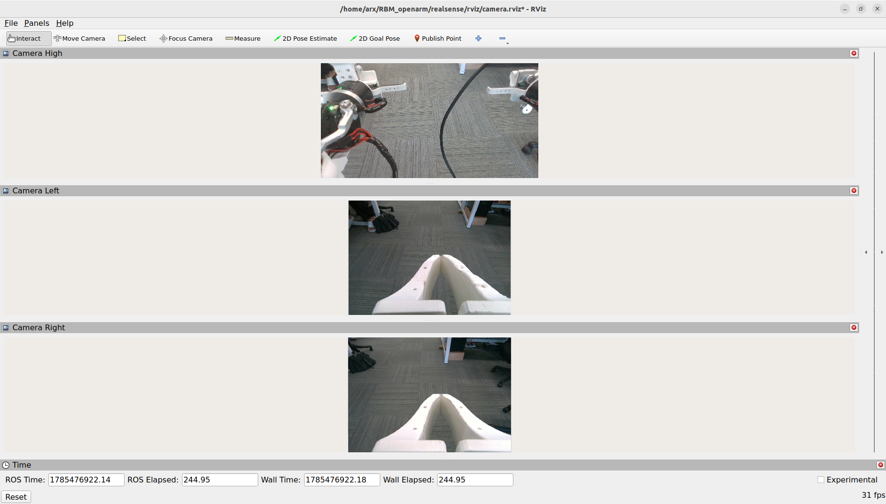

安装附件：

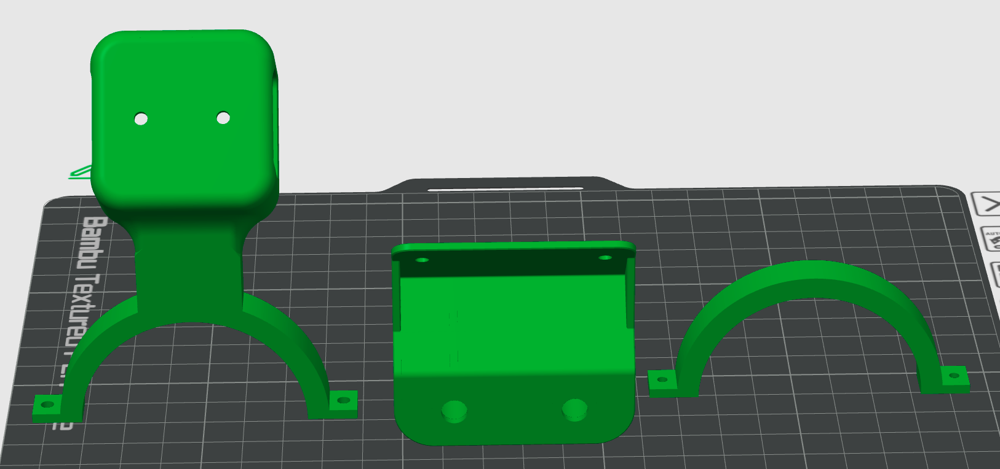

- [胸前 D435 模型](docs/attachments/chest-camera_D435.stl)
- [左腕 D405 模型](docs/attachments/wrist-camera_D405_1.stp)
- [右腕 D405 模型](docs/attachments/wrist-camera_D405_2.stp)

---

## 11. VR 遥操作

使用前确认：

1. 已按 [§5.1](#51-安装-xrobotoolkit-pc-service-deb) / [§5.3](#53-vr-与采集-python-依赖) / [§5.4](#54-安装-pico-头显-apk) 完成安装
2. 已按 [§1](#1-仿真--真机运行前联机-pc-service-与-pico) 启动 PC Service，并在 PICO 打开 `XRoboToolkit`、同网联机
3. `conda activate openarm` 可用
4. 真机时 `can0`/`can1` 已配置且机械臂已标定

推荐：**菜单 12**（全身）或 **5 + 8**。PC Service 启动命令见 [§1](#1-仿真--真机运行前联机-pc-service-与-pico)。

假硬件：

```bash
cd ~/Medibot_openarm
./openarm_ws/scripts/teleop/launch_vr_teleop.sh --fake --bimanual
```

真实双臂：

```bash
./openarm_ws/scripts/teleop/launch_vr_teleop.sh --real --bimanual
```

启动前确认：

```text
==========================================
  VR 遥操作 OpenArm — 启动前请确认
==========================================

准备工作：
  1. XRoboToolkit PC Service 已启动
     bash /opt/apps/roboticsservice/runService.sh

  2. PICO 头显已开机、已安装 APK，与 PC 同网

  3. openarm 环境已激活
     conda activate openarm  或  source ~/Medibot_openarm/openarm_env/bin/activate

  4. [真硬件] CAN 接口已配置，电机已使能

------------------------------------------
以上均已完成？按 Enter 继续，Ctrl+C 取消：
```

脚本会依次启动 OpenArm bringup、XR Bridge、VR IK。`Ctrl+C` 结束整组。更细说明见 [`docs/openarm/launch_vr_teleop_usage.md`](docs/openarm/launch_vr_teleop_usage.md)。

---

## 12. HDF5 数据采集与回放

推荐菜单 **13**（采集）/ **14**（回放）。也可在话题已就绪时手动运行。详见 [`data_collection/README.md`](data_collection/README.md)。

依赖：

```bash
conda activate openarm
pip install h5py opencv-python pyyaml
```

### 12.1 采集

需相机、`/joint_states`、TF 末端、可选 `/odom` `/cmd_vel`：

```bash
cd ~/Medibot_openarm
source source_all.sh
conda activate openarm
python data_collection/data_collection.py
```

就绪后类似：

```text
[INFO] [openarm_data_collection]: Ready. Topics: joints=/joint_states odom=/odom cmd_vel=/cmd_vel ee=[openarm_left_hand_tcp, openarm_right_hand_tcp]
[INFO] [openarm_data_collection]: Press SPACE to start/stop collection, ESC to quit.
```

操作与保存示例：

```text
[INFO] [openarm_data_collection]: Data collection started.
[INFO] [openarm_data_collection]: episode_frames=30
[INFO] [openarm_data_collection]: Data collection stopped, frames=120.
[INFO] [openarm_data_collection]: Saving episode to /home/<user>/Medibot_openarm/datasets/episode_0.hdf5
[INFO] [openarm_data_collection]: Saved episode to /home/<user>/Medibot_openarm/datasets/episode_0.hdf5
```

- **SPACE**：开始 / 停止并保存  
- **ESC**：退出  
- 输出：`~/Medibot_openarm/datasets/episode_N.hdf5`

主要字段：

| 路径 | 说明 |
|------|------|
| `data/demo_0/observations/qpos` | 左右臂 7 + 夹爪 + 7 + 夹爪（16） |
| `data/demo_0/observations/qvel` | 同上速度 |
| `data/demo_0/observations/eef` | 左右末端各 xyz+quat（14） |
| `data/demo_0/observations/odom` | 底盘里程计 13 维 |
| `data/demo_0/observations/cmd_vel` / `actions_base` | 底盘速度命令 6 维 |
| `data/demo_0/observations/images/{head,left_wrist,right_wrist}` | JPEG |

### 12.2 回放

需 `forward_position` 驱动（勿与 VR IK 同时开）；回放底盘时再开底盘驱动。菜单 **14** 会一并拉起。

```bash
cd ~/Medibot_openarm
source source_all.sh
conda activate openarm
python data_collection/replay.py
```

选择数据集示例：

```text
========== 可选数据集 ==========
  [0] episode_0.hdf5  (45.2 MB)  /home/<user>/Medibot_openarm/datasets/episode_0.hdf5
  [1] episode_1.hdf5  (52.8 MB)  /home/<user>/Medibot_openarm/datasets/episode_1.hdf5
================================
请输入数据集序号 [0-1]，或 episode 编号（直接 Enter=最新 episode_1）：1
[INFO] [replay]: 已选择 [1] episode_1.hdf5
[INFO] [replay]: Replay loaded: file=.../episode_1.hdf5 demo=0 frames=360
[INFO] [replay]: Ready. Press SPACE to start/stop replay, ESC to quit.
```

- 输入列表下标或 `episode_N` 编号；Enter = 最新  
- **SPACE**：播放 / 暂停；**ESC**：退出（默认回 home）  
- 底盘 `/cmd_vel` 限幅与 VR 一致：线速度 0.1 m/s，角速度 0.2 rad/s  
- 跳过选择：`--latest` 或 `--replay-hdf5-path datasets/episode_0.hdf5`

---

## 13. 命令行全栈启动

查看选项：

```bash
./openarm_ws/scripts/launch_full_stack.sh --help
```

帮助输出示例：

```text
Usage: launch_full_stack.sh [components] [options]

Components:
  --arm       Launch OpenArm bringup
  --chassis   Launch Ranger Mini V3 bringup
  --cameras   Launch three RealSense cameras and RViz
  --vr        Launch VR arm teleoperation (includes OpenArm bringup)
  --record    Run data_collection.py (SPACE to record; needs openarm env)
  --all       Launch chassis, cameras, VR and recording

Options:
  --real-arm          Use real OpenArm hardware (default: fake hardware)
  --episode NAME      Unused for data_collection (kept for CLI compatibility)
  -h, --help          Show this message

Tip: daily workflows prefer ./openarm_ws/scripts/control_menu.sh (11–14).
```

假机械臂 + 相机：

```bash
./openarm_ws/scripts/launch_full_stack.sh --arm --cameras
```

真实底盘、相机、VR 与采集：

```bash
./openarm_ws/scripts/launch_full_stack.sh --all --real-arm
```

`--vr` 已含机械臂 bringup，不能再同时加 `--arm`。日常仍优先控制菜单。

---

## 14. 常见问题

### 构建出现 `setuptools_scm` / `empy` / `catkin_pkg` 冲突

不要在 Conda 里直接 `colcon build`：

```bash
cd ~/Medibot_openarm
./openarm_ws/scripts/build.sh
```

### 编译报 `asio.hpp` / `hardware_interface` / `diagnostic_updater`

按 [§3.2](#32-apt-依赖) 补齐依赖后重编：

```bash
sudo apt install -y libasio-dev \
  ros-humble-hardware-interface ros-humble-controller-manager \
  ros-humble-ros2-controllers ros-humble-moveit ros-humble-xacro \
  ros-humble-diagnostic-updater ros-humble-librealsense2 \
  ros-humble-compressed-image-transport
cd ~/Medibot_openarm && ./openarm_ws/scripts/build.sh
```

### `setup_conda.sh --install` 长时间下载 torch / CUDA

本工程不需要。请按 [§5.3](#53-vr-与采集-python-依赖) 只装 `xrobotoolkit_sdk` + `placo` + 采集 pip 包。若误装可中断下载，不影响已装好的 SDK。

### `libPXREARobotSDK.so` 找不到 / XR Bridge 无法初始化

未安装 PC Service deb，或未启动服务。按 [§5.1](#51-安装-xrobotoolkit-pc-service-deb) 执行 `sudo dpkg -i ...`，确认：

```bash
ls /opt/apps/roboticsservice/SDK/x64/libPXREARobotSDK.so
bash /opt/apps/roboticsservice/runService.sh
```

### Conda 报 Terms of Service / `CondaToSNonInteractiveError`

见 [§5.2](#52-创建-openarm) 的 `conda tos accept` 命令。

### `AMENT_PREFIX_PATH` 指向旧工作空间

新终端只加载统一环境：

```bash
source /opt/ros/humble/setup.bash
source ~/Medibot_openarm/source_all.sh
```

检查 `~/.bashrc`，删除旧的 `ros2_ws`、`agilex_ws` 或 `realsense/install` 加载命令。

### `can2` 显示 UP，但 `candump can2` 无数据

检查底盘电源、急停、CAN 线序、终端电阻、USB-CAN 驱动和接口名。`can2 is up` 只表示 Linux 接口配置成功。

### RealSense：RViz 黑屏 / 无 `/compressed` 话题

1. 确认节点在跑且有原始图：`ros2 topic list | grep image_rect_raw`  
2. 安装压缩插件：`sudo apt install -y ros-humble-compressed-image-transport`  
3. **重启**相机（菜单 **0** 再 **9**），再查：`ros2 topic list | grep compressed`  
4. RViz 配置见 `openarm_ws/scripts/sensors/rviz/camera.rviz`（默认订 compressed）

其它：

- 确认没有重复的 RealSense 节点  
- 使用 USB 3.x，避免无供电 HUB  
- RViz Image 使用 Best Effort、队列深度 1  
- `lsusb` / `rs-enumerate-devices` 确认三台在线，序列号与脚本一致  

### 回放与 VR 抢控制器

回放需要 `forward_position_controller`；VR IK 也占用同一控制器。请先菜单 **0** 关掉 VR，再用 **14**。

---

## 15. 参考资料

- [OpenArm](https://github.com/enactic/openarm_ros2)
- [Ranger ROS 2](https://github.com/agilexrobotics/ranger_ros2)
- [Ranger Mini 3.0](https://www.agilex.ai/page/6908c1285e78cfa260412be9)
- [XRoboToolkit](https://github.com/XR-Robotics)
- [XRoboToolkit PC Service（deb）](https://github.com/XR-Robotics/XRoboToolkit-PC-Service/releases)
- [XRoboToolkit PICO APK](https://github.com/XR-Robotics/XRoboToolkit-Unity-Client/releases)
- [RealSense ROS](https://github.com/IntelRealSense/realsense-ros)
- 本仓库：[`docs/openarm/`](docs/openarm/)、[`docs/openarm/vr_deployment_guide.md`](docs/openarm/vr_deployment_guide.md)、[`data_collection/README.md`](data_collection/README.md)
